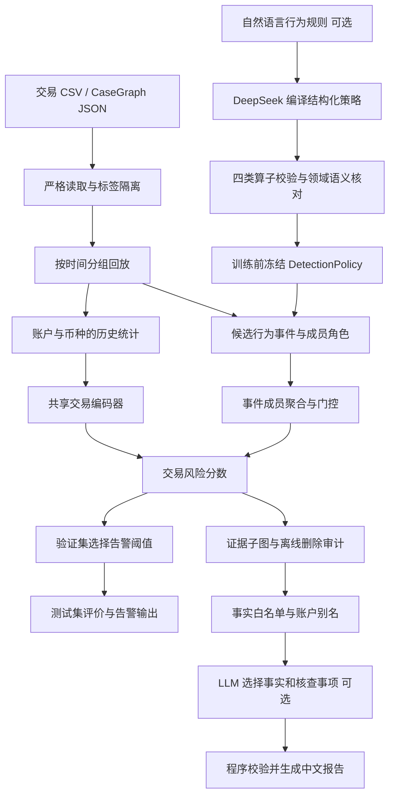

# HAMLET-KG：知识引导的时序事件图洗钱检测

> v0.6 · 研究原型 · 主要投稿目标：Knowledge and Information Systems（KAIS）
>
> 主任务：在只使用当前及历史交易的条件下，为每笔交易生成洗钱风险分数、候选行为事件和可回溯的交易证据。
>
> 当前代码已支持磁盘数据准备、因果样本缓存、按批训练、神经模型与 LightGBM 对照、多种子汇总、模型恢复，以及小规模证据删除审计和可选的 DeepSeek 报告。完整 HI-Small 的 5,078,345 笔已通过适配器严格校验并建立磁盘索引，最早六小时的 511,357 笔已进入公开数据先导实验。**全时间范围训练与正式论文实验仍未完成，尚未证明性能优势或真实银行适用性。** 具体结果见 [实验记录](docs/experiment_progress.md)。

## 1. 研究定位

建议硕士论文题目：**《基于时序事件知识图谱的可解释洗钱交易检测方法研究》**。

期刊论文可以暂用：*Knowledge-Guided Temporal Event Aggregation for Explainable Anti-Money Laundering Detection*。题目与最终贡献应根据真实实验结果调整。

项目重点研究：将“汇入、转出、过账、资金接力”等领域行为表示为事件，保留成员交易及其角色，能否提高未来交易的检测能力，并提供能够接受检验的证据。

### 1.1 与 KAIS 及上海交大研究方向的联系

[KAIS 的官方范围](https://link.springer.com/journal/10115/aims-and-scope)包括知识与数据工程、知识发现及相关系统应用。项目的投稿价值需要由清晰的方法问题、强基线和充分实验支撑，系统功能本身不能证明方法贡献。

上海交大教师的官方中文姓名为**丁家昕（Jiaxin Ding）**。其[官方教师页](https://www.cs.sjtu.edu.cn/jiaoshiml/dingjiaxin.html)及[个人主页](https://jhc.sjtu.edu.cn/~jiaxinding/)可作为研究方向参考。[TopInG（ICML 2025）](https://proceedings.mlr.press/v267/xin25b.html)研究图学习的解释子图和拓扑依据。这里借鉴的是“预测应有结构依据，解释与泛化需要验证”的研究问题；**本项目没有实现 TopInG 的持久同调算法，也不代表与该教师有合作或获得招生承诺。**

KAIS 在 [CCF 2026 第七版目录](https://www.ccf.org.cn/Academic_Evaluation/By_category/2026-03-31/870181.shtml)中属于 B 类。学校采用的目录版本仍需按本校要求确认。

### 1.2 核心待验证假设

- **H1：事件成员关系有用。** 保留多笔交易属于同一行为事件，比将事件压缩成计数和数值摘要更有效。
- **H2：角色与时间有用。** 入账、出账、接力位置和时间跨度提供独立收益。
- **H3：证据可检验。** 删除支持交易并重建全部派生特征后，预测应发生可测量的变化；变化应与合适的随机对照比较。
- **H4：知识有助于稳健性。** 换洗钱稀有程度、扰动金额或移除交易时，方法仍具有可重复的收益。

这些都是实验问题。把事件图与神经网络组合起来，并不自动构成新颖方法。

## 2. 当前实现与边界

| 内容 | 当前状态 |
|---|---|
| IBM AML 原始 CSV 读取 | 已实现；支持两个同名 `Account` 列、严格字段验证、标签隔离 |
| 磁盘数据与因果样本缓存 | 已实现；SQLite 时间索引、独立标签表、成员交易引用、来源摘要和完整时间组切分 |
| 因果历史与候选事件 | 已实现；账户/币种/方向分桶、有界窗口、同时间戳分组 |
| 交易级神经检测 | 已实现；CPU PyTorch，缓存按批读取与有界打乱，冻结训练集标准化参数 |
| 内部对照与消融 | 已实现 `base / flat / event / no_role / no_time / untyped_event` |
| 原生 LightGBM 对照 | 已实现 `lgbm_base / lgbm_flat`；基础特征与相同事件摘要，不是 GFP 复现 |
| 数据审计与多种子实验 | 已实现标签覆盖、时间/重复/币种审计，固定划分的均值、样本标准差与配对差值 |
| 时间划分与阈值选择 | 已实现；完整时间戳组划分；阈值只使用验证集标签 |
| AP、分类指标与每日告警预算 | 已实现；同分 AP 分组；UTC 日预算向下取整 |
| 证据图与删除审计 | 已实现；移除源交易、重建前缀、等规模随机删除和仅保留证据 |
| 运行记录和模型恢复 | 已实现；数据 SHA-256、配置、版本、划分、模型与 sidecar 配对校验 |
| DeepSeek 配置与连接检查 | 已实现；本地 `.env`、环境覆盖、JSON 请求、有限重试、错误脱敏 |
| 自然语言编译为检测规则 | 已实现固定四类算子的严格策略结构；策略实际参与构图并随模型冻结 |
| LLM 证据核查报告 | 已实现事实编号选择与核查枚举；程序生成中文叙述并保留审计限制 |
| 完整公共数据主实验与跨配置实验 | 待完成 |
| GFP + LightGBM、Multi-GNN 强基线 | 待集成；内部对照不能替代它们 |
| 跨生成器泛化、案例链隔离、统计显著性 | 待完成 |
| 全局异构 GNN、任意长度路径、通用 cycle | 未实现 |
| 在线服务、持久化流状态、真实银行部署 | 未实现；当前支持离线因果回放及其磁盘缓存 |

LLM 有三个明确入口：训练前把自然语言编译为检测策略，评分后组织已有交易证据，以及旧流程中的文本原子事件抽取。**训练、逐笔评分和证据删除回放均不调用 LLM**，使用手写策略或默认策略即可独立运行。LLM 不输出交易洗钱标签，也不参与分类器的每笔决策。

旧案例检索、通用规则 DSL 与 FGW 继续可用；旧 `compile-pattern` 和新的 `compile-detection-rules` 输出不同结构。旧说明保存在 [legacy_case_retrieval.md](docs/legacy_case_retrieval.md)。

## 3. 系统流程



### 3.1 因果观察规则

对时间为 `t` 的目标交易，输入由**自身与严格早于 `t` 的历史交易**组成：

`score(tx_t) = model(features(tx_t, history_before_t), events_completed_at_t)`

- 同时间戳的交易先各自构造样本，再统一更新历史，不人为创造组内先后关系。
- 后续交易不能改变此前样本；历史成员使用其到达时已经计算好的特征。
- 已完成事件只参与当前交易评分。未来完成的事件不回填给早期交易。
- 训练、验证、测试共享时间上可见的历史交易，但只有训练段标签参与优化；验证段标签只用于阈值选择。
- 这是历史可见、标签隔离的持续交易检测协议。时间划分并不保证同一注入资金链不会跨边界，正式实验还需使用可获得的模式归属审计。

### 3.2 三类对象与关系

- **账户**：用于组织历史与追溯，不把账户编号或银行编号作为数值特征。
- **交易**：时间、付款/实收金额、付款/收款币种、发送方、接收方及来源行号。
- **行为事件**：候选类型、中心账户、成员交易、成员角色、时间跨度和金额比例。

输出证据图包含 `SENDER_OF`、`RECEIVER_OF`、带角色的 `MEMBER_OF` 关系。它表达已观察到的交易组成，不能证明某笔出账对应某笔入账的真实资金来源。

模型直接消费有界的交易—事件关联结构。账户组织上下文，但不是当前神经模型中的可学习账户节点；因此这里是**局部事件聚合编码器**，不能描述成已经实现全局异构图消息传播。

### 3.3 基础特征与币种处理

当前有 24 个固定数值特征：付款/实收金额的 `log1p`，是否同币种/自转账，小时周期特征，以及发送方和接收方各入出方向的历史数量、金额、不同对手方、距上次交易的间隔和当前金额偏离历史均值。

历史按 `(账户, 币种, 入/出方向)` 分桶，各桶同时受时间窗口和 `max_history` 限制。接收方历史使用实收金额与收款币种，发送方历史使用付款金额与付款币种。金额比较在中间账户的相同币种下进行；不跨币种直接求和，也没有外部汇率归一化。

神经模型默认基础标准化仅在训练交易及其训练时可见成员上拟合，随后冻结。新增 `fixed_periodic` 可让 `hour_sin/hour_cos` 保持其天然 `[-1,1]` 范围，其他列仍使用训练统计，详见 6.6。LightGBM 的基础标准化只拟合训练段当前交易；树模型不编码历史成员向量。两者均不使用验证/测试统计量，事件摘要均不另行标准化。标签、模拟器的注入类别、目录名和未来信息不进入特征。

### 3.4 四类候选事件

| 候选类型 | 成立条件与当前范围 |
|---|---|
| `fan_in` | 当前交易与接收账户较早入账构成至少 `min_fan` 个不同发送方 |
| `fan_out` | 当前交易与发送账户较早出账构成至少 `min_fan` 个不同接收方 |
| `pass_through` | 当前出账 / 中间账户窗口内有界入账总额位于比例区间 |
| `relay` | 三笔严格按时间先后、四个不同账户的接力；两个中间账户各自币种与金额比例匹配 |

默认窗口 24 小时，每桶最多 32 笔历史，不同对手方下限为 3，过账比例范围为 `[0.8, 1.2]`。这些是研究默认值，需在训练/验证阶段选择，不能解释为监管阈值。

历史截断会遗漏较早交易，因此金额比是**有界观察中的候选关系**。每笔目标对每条 relay 规则最多构造 `max_history` 个实例；默认配置只有一条 relay 规则，不枚举任意路径或环。正常工资代发、内部归集和结算也可能命中这些模式，事件命中不是洗钱真值。

算子的确定性实现位于 `detection/stream.py`。不传 `--policy` 时沿用 `StreamConfig` 的四类默认事件；传入时，只执行策略列出的规则，每条规则可以有独立时间窗和阈值。同一算子允许多条规则，事件记录其 `rule_id`。策略校验位于 `detection/policy.py`。

`StreamConfig.window_seconds` 和 `max_history` 始终决定保留历史的容量；策略窗口不能超过保留窗口，人数要求不能超过可保留历史，程序会拒绝无法满足的配置。提供策略后，`--min-fan`、`--ratio-min/max` 不再决定事件成立条件；应在策略中设置这些条件。基础历史特征仍按保留历史计算。

修改旧 `patterns/*.json` 不会改变新检测算子；旧 DSL 继续服务于 `materialize`。修改新策略会改变事件输入，必须重新训练，不应在冻结模型测试时替换策略。

## 4. 模型与对照

`event` 模型的计算过程：

1. 用共享 MLP 编码当前交易及事件成员的标准化特征。
2. 将成员编码、角色嵌入和 `log1p(时间间隔)` 输入成员编码器。
3. 在一个事件内做带 mask 的成员均值聚合，再加入类型嵌入、时间跨度、金额比例及成员数量。
4. 通过可学习 sigmoid 门控聚合事件，与当前交易编码拼接，输出未校准的风险分数。

没有候选事件时，事件分支为零，基础分支仍可评分。门控权重本身不被当作忠实解释。

| 配置 | 输入与用途 |
|---|---|
| `base` | 24 个交易/历史特征的 MLP；基础学习对照 |
| `flat` | 基础特征 + 每类事件数量、成员数量、平均跨度和平均金额比摘要；去掉成员组成 |
| `event` | 完整成员组成、角色、事件类型与时间信息 |
| `no_role` | 相同事件结构与模型维度，成员角色嵌入置零 |
| `no_time` | 事件成员间隔及事件跨度置零；仍保留基础时间特征、时间窗和事件成立约束 |
| `untyped_event` | 保留成员分组与交易编码，事件类型、角色、时间和数值描述置零 |
| `lgbm_base` | 原生 CPU LightGBM，使用相同 24 个基础特征；由 `detect-benchmark` 或 `detect-cached-benchmark` 训练 |
| `lgbm_flat` | LightGBM 使用基础特征 + 与 `flat` 相同的 16 个事件摘要；不编码成员向量 |

`untyped_event` 是同结构的聚合对照，并不是独立复现的标准 RGCN。`no_time` 只能衡量事件时间编码的作用，不能用来声称移除了整个系统的时间信息。

神经训练采用小批量 Adam 和二元交叉熵。默认 `--class-weight balanced`，正类权重仅由训练标签计算为 `Nnegative / Npositive`；使用 `--class-weight none` 可关闭。树模型使用训练类别权重 `N / (2 × Nclass)`，正负权重之比相同；默认 100 轮、学习率 0.05、15 个叶子，固定单线程，不做验证早停。所有配置共享候选、时间划分、历史政策和评价预算，分别在验证段选择阈值；这些默认参数不是充分调参或计算预算对齐的证明。风险分数未经概率校准，不应当作精确洗钱概率。

## 5. 安装与快速运行

Python 3.10 或更高版本。读取、规则、数据特征和指标模块只依赖标准库；神经检测需要 PyTorch 和 NumPy。

```bash
cd "/Users/zhangyao/Desktop/科研/hamlet-kg"
python3 -m venv .venv-detection
source .venv-detection/bin/activate
python -m pip install -e '.[detection]'
```

新机器需使用自己的仓库路径。可选依赖列表见 `requirements-detection.txt`。本次开发环境的精确依赖见 `requirements-detection-lock.txt`；固定版本能帮助复现，但不同操作系统与 Python 版本仍需兼容的 PyTorch wheel。

### 5.0 安装包含树模型的实验环境

```bash
python -m pip install -e '.[benchmark]'
```

完整依赖列表与本机版本分别见 `requirements-benchmark.txt`、`requirements-benchmark-lock.txt`。LightGBM 使用原生 `Dataset / train / Booster`，无需 scikit-learn，也不通过 pickle 保存模型。`audit-data` 和汇总模块仍仅依赖标准库；神经和树模型的依赖在实际使用时加载。

macOS 标准 wheel 可能需要 OpenMP 运行库，常规安装方式参见 [LightGBM 官方安装指南](https://lightgbm.readthedocs.io/en/stable/Installation-Guide.html)。本机没有安装全局运行库，验证环境采用如下源码构建：

```bash
python -m pip install --no-binary=lightgbm 'lightgbm==4.7.0' \
  --config-settings=cmake.define.USE_OPENMP=OFF --force-reinstall --no-deps
```

这是无 OpenMP 的单线程构建，不能用其速度代表常规多线程 LightGBM。本机 SciPy 1.15.3 的原生 PROPACK 库加载失败，已用兼容的 1.14.1 wheel 完成验证；其他平台应选择适配自身 Python 和系统的依赖。版本锁定文件本身不记录原生构建选项，复现时需同时保存这一说明。

### 5.1 内置演示

```bash
hamletkg detect-demo \
  --output outputs/kais-smoke \
  --epochs 3 \
  --variants event base flat \
  --explain-top-k 2 \
  --explanation-max-candidates 2
```

命令生成 24 天、1080 笔的小型合成交易文件，包含标注的注入行为以及结构相似的正常行为，然后运行完整管线。该数据由本项目生成，**不是 IBM AMLworld，不可作为论文主结果或独立外部数据集**。它的正类比例和生成规律仅为功能验证服务。

默认每日预算比例很小，在演示数据上经常得到 `B=0`；程序会如实报告零预算日期。如需观察预算输出，可在演示命令中增加 `--budget-fractions 0.05 0.1`，但这些比例只是演示参数。

### 5.2 所有内部对照与消融

```bash
hamletkg detect-demo \
  --output outputs/kais-ablations \
  --epochs 5 \
  --variants base flat event no_role no_time untyped_event \
  --class-weight balanced \
  --explain-top-k 1
```

### 5.3 不安装为包时

```bash
PYTHONPATH=src .venv-detection/bin/python -m hamletkg detect-demo \
  --output outputs/kais-smoke --epochs 3 --explain-top-k 1
```

### 5.4 DeepSeek 本地配置

本机的密钥已经写入仓库根目录 `.env`，文件权限为 `0600`，被 Git 忽略。下面的步骤供新机器使用；已经配置好的机器无需覆盖 `.env`。

```bash
cp .env.example .env
chmod 600 .env
```

编辑 `.env`，把占位符替换为自己的密钥。配置文件不会作为 shell 脚本执行，也不会修改当前进程的全局环境：

```dotenv
HAMLET_LLM_BASE_URL=https://api.deepseek.com/v1
HAMLET_LLM_MODEL=deepseek-v4-flash
HAMLET_LLM_API_KEY=YOUR_API_KEY
HAMLET_LLM_TIMEOUT_SECONDS=45
HAMLET_LLM_THINKING=disabled
HAMLET_LLM_MAX_TOKENS=2048
HAMLET_LLM_RETRIES=2
HAMLET_LLM_BACKOFF_SECONDS=0.5
HAMLET_LLM_PROXY_URL=
HAMLET_LLM_CA_FILE=
```

- 配置优先级：进程中的 `HAMLET_LLM_*` 环境变量覆盖配置文件；文件位置由 `--env-file`、`HAMLET_LLM_ENV_FILE` 或当前目录 `.env` 依次选择。
- 代理为空时读取系统代理；如本机需要代理，在 `HAMLET_LLM_PROXY_URL` 填入对应 HTTP 地址。代理只作用于这个客户端，不改全局网络设置。
- 使用 JSON 输出模式与 `thinking: disabled`。只对 HTTP 429 和 5xx 做有限退避重试；401、402、规则校验失败不会被默认规则或虚构报告掩盖。
- `CA_FILE` 可指定可信证书文件。项目不关闭 TLS 证书验证，也不在日志或运行清单中保存密钥。

检查模型列表和鉴权：

```bash
hamletkg llm-check --output outputs/deepseek/models_check.json
```

如需实际验证 JSON 生成，显式运行一次小请求：

```bash
hamletkg llm-check --generate --output outputs/deepseek/generation_check.json
```

**最新真实接口验证状态（2026-10-08）：充值后，鉴权及 JSON 生成成功；两次真实规则编译均通过结构校验、参数一致且无需修复，三笔交易的证据报告均成功生成。** 请求模型名保持 `deepseek-v4-flash`，接口实际返回 `deepseek-flash`。此前 HTTP 402 是余额不足的历史失败，已不再是当前阻碍。成功记录位于本机 `outputs/deepseek/generation_check.json`，生成策略位于 `outputs/deepseek/compiled_policy.json`。

按 [DeepSeek 当前官方模型说明](https://api-docs.deepseek.com/quick_start/pricing/)，`deepseek-v4-flash` 是兼容名称，当前路由到 V4.1-Flash，推荐名称为 `deepseek-flash`。项目保留用户指定名称，并记录服务实际返回的模型名；模型列表未列出兼容名时，不自动判定该名称不可调用。接口契约参见 [JSON 输出说明](https://api-docs.deepseek.com/guides/json_mode/) 和 [思考模式说明](https://api-docs.deepseek.com/guides/thinking_mode/)。

### 5.5 自然语言规则 → 可执行检测策略

```bash
hamletkg compile-detection-rules \
  --rule examples/detection_rules.txt \
  --samples 1 \
  --output outputs/deepseek/compiled_policy.json
```

输出分为 `policy` 和 `compilation`：前者是严格的执行结构，后者记录有效样本率、重复生成的一致率、修复次数、规则文本校验和与模型返回信息。`--samples` 允许 1–5；结构错误最多修复一次。重复生成一致或结构校验通过，都不能证明正确理解了原文。

目前只能表达以下四种固定算子：

| 算子 | 通用字段外允许的条件 |
|---|---|
| `fan_in / fan_out` | `min_counterparties`，至少 2 个不同对手方 |
| `pass_through` | `min_incoming`、`ratio_min`、`ratio_max` |
| `relay` | `ratio_min`、`ratio_max`，逐个中间账户比较；固定三笔交易、四账户 |

所有规则具有 `rule_id`、`operator` 和正数 `window_seconds`。不能表达国别、制裁名单、单笔金额上限、任意环或任意路径；若模型明确返回“不支持”，编译失败，不静默近似执行。对于模型漏掉原文条件的情况，结构校验无法发现，仍需在训练前逐项核对原文与策略。

可手工编写以下结构，也可读取带 `policy/compilation` 包装的 LLM 输出：

```json
{
  "policy_id": "P-EXAMPLE",
  "version": "1.0",
  "rules": [
    {
      "rule_id": "R-PASS",
      "operator": "pass_through",
      "window_seconds": 86400,
      "min_incoming": 3,
      "ratio_min": 0.8,
      "ratio_max": 1.2
    }
  ]
}
```

这份策略只启用过账事件。仓库中的 [detection_policy.json](examples/detection_policy.json) 是启用四类算子的**手写参考配置**，不是尚未成功的真实 LLM 输出。

### 5.6 使用策略完成训练与恢复

无 API 也可先运行参考策略，验证整个检测流程：

```bash
hamletkg detect-demo \
  --policy examples/detection_policy.json \
  --output outputs/kais-policy-smoke \
  --epochs 3 --variants event base flat \
  --explain-top-k 2 --explanation-max-candidates 2
```

真实编译成功后，将 `--policy` 换为 `outputs/deepseek/compiled_policy.json`；公开数据训练的 `detect-train` 同样支持该参数。时间窗若超过 24 小时，同时提高 `--window-hours`，否则校验会拒绝。

运行清单与模型 sidecar 保存完整策略；checkpoint 内保存策略及历史配置摘要。恢复评分自动读取训练时的策略，无需再次调用 LLM。编辑 sidecar 改变规则或历史配置会触发拒绝，防止训练与评分使用不同输入定义。

### 5.7 已完成真实 API 验证的演示闭环

在完成上述配置与规则编译后，可以按以下步骤复现这次演示：

```bash
hamletkg detect-demo \
  --policy outputs/deepseek/compiled_policy.json \
  --output outputs/kais-deepseek-live \
  --epochs 3 --variants event base flat \
  --explain-top-k 3 --explanation-max-candidates 2

hamletkg describe-alerts \
  --evidence outputs/kais-deepseek-live/evidence.json \
  --output outputs/kais-deepseek-live/llm-report \
  --max-transactions 3

hamletkg detect-score \
  --csv outputs/kais-deepseek-live/smoke_transactions.csv \
  --case-id SMOKE-ONLY \
  --model outputs/kais-deepseek-live/model_event.pt \
  --after 2026-01-20T05:14:00Z \
  --output outputs/kais-deepseek-live/restored \
  --explain-top-k 0
```

真实生成策略的四条参数与手写参考一致，并用于 1080 笔演示交易的训练；恢复后的 216 笔评分与训练输出一致。中文结果在 `outputs/kais-deepseek-live/llm-report/report.md`，来源引用、覆盖与接口信息在同目录 `report.json`。这是一次真实 API 与演示数据的工程验证，不能推出通用规则编译正确率或公开数据检测性能。

## 6. 使用公开 IBM 交易数据

主数据建议来自 [IBM AML-Data 官方仓库](https://github.com/IBM/AML-Data)，背景见 [NeurIPS 2023 数据论文](https://research.ibm.com/publications/realistic-synthetic-financial-transactions-for-anti-money-laundering-models)。数据为合成交易，有交易级洗钱标签。下载前阅读上游数据许可；本仓库不自动下载或重新分发数据。

**本机已获取官方 Kaggle 版本 8 的 HI-Small 交易与模式说明文件**，来源与校验值见 `data/ibm_aml_manifest.json`。全文件有 5,078,345 笔、5,177 个正例（约 0.102%），时间范围为 2022-09-01 至 2022-09-18，原始行不按时间排序。v0.6 已对全文件执行适配器严格校验，包括时间、参与方、有限正金额、币种和标签，建立保留原始行号的 SQLite 索引；业务重复记录与洗钱注入链归属仍待全量审计。

固定 20k/50k/100k 原始前缀只覆盖最初半小时，测试段均无正例，不能评价检出能力。新磁盘流程从全文件取预先定义的最早六小时，保留该时段所有 511,357 笔，测试有 27 个正例，可以计算检出指标，但训练段仅 15 个正例，仍是先导实验。LI-Small 和完整时间范围训练未完成。详见 [实验进度与问题记录](docs/experiment_progress.md)。

把 CSV 放到被 Git 忽略的目录，例如：

```text
data/raw/ibm/HI-Small_Trans.csv
data/raw/ibm/LI-Small_Trans.csv
```

HI-Small 与 LI-Small 来自同一生成器，可以用于跨配置验证，不能称为两个独立真实来源。AMLSim 的账户欺诈标签不能代替 IBM 的交易级洗钱标签。Elliptic 的 illicit 标签也不能直接等同于银行洗钱标签。

### 6.1 原始表头与读取行为

```text
Timestamp,From Bank,Account,To Bank,Account,Amount Paid,Payment Currency,Amount Received,Receiving Currency,Payment Format,Is Laundering
```

适配器按位置保留两列 `Account`，也支持已重命名为 `Account.1` 的第二列，以及明确的 `From Account / To Account`。

- 必需字段缺失、列数错误、非有限/非正金额、非法时间和非法二元标签都会报错。
- `Is Laundering` 可缺失或留空；这种交易保持未标注，评分可运行，监督训练会明确拒绝缺标签样本。
- 标签仅保存于 `case.metadata.evaluation_labels`，不放入交易属性或模型输入。
- 日期无时区时按 UTC 解释，不自动推断银行所在时区。
- 当前通道字段保留供追溯，但不作为神经模型输入。

### 6.2 训练与评价

```bash
hamletkg detect-train \
  --csv data/raw/ibm/HI-Small_Trans.csv \
  --case-id IBM-HI-SMALL \
  --output outputs/ibm-hi-small-seed42 \
  --variants base flat event no_role no_time untyped_event \
  --epochs 20 --batch-size 64 --hidden-dim 32 \
  --class-weight balanced --seed 42 \
  --train-fraction 0.6 --validation-fraction 0.2 \
  --window-hours 24 --max-history 32 --min-fan 3 \
  --ratio-min 0.8 --ratio-max 1.2 \
  --budget-fractions 0.001 0.005 0.01 \
  --explain-top-k 0
```

首次排查可增加 `--limit 20000`，但 CSV 前若干行不是正式抽样协议，并可能缺少正类。训练段和验证段均必须包含两类标签；程序不会为让指标成立而重采样测试集。

此 `detect-train` 路径把交易与所有样本保存在内存，PyTorch 小批量只限制张量规模。大文件请使用下文 6.6 的磁盘流程，并关闭昂贵的删除审计；完成全量数据准备不等于完成全量训练，也没有在任意机器上运行的保证。

若先导入 JSON，应跳过旧离线关系构建：

```bash
hamletkg import-ibm \
  --csv data/raw/ibm/HI-Small_Trans.csv \
  --case-id IBM-HI-SMALL --skip-relations \
  --output outputs/ibm-hi-small.json

hamletkg detect-train \
  --case outputs/ibm-hi-small.json \
  --output outputs/ibm-hi-from-json --epochs 20 --explain-top-k 0
```

### 6.3 恢复模型并评分

```bash
hamletkg detect-score \
  --csv outputs/kais-smoke/smoke_transactions.csv \
  --case-id SMOKE-ONLY \
  --model outputs/kais-smoke/model_event.pt \
  --after 2026-01-20T05:14:00Z \
  --output outputs/kais-score \
  --explain-top-k 1
```

`.pt` 与同名 `.json` 必须一起保留。JSON 保存事件配置、冻结策略、特征顺序、验证阈值和模型 SHA-256；恢复时检查配对及训练配置摘要。PyTorch 使用 `weights_only=True` 加载张量与普通配置。已包含模型 SHA-256 配对信息的 v0.3 无策略 checkpoint 可继续恢复。

LightGBM 则需同时保留三个文件：`.txt` 原生模型、`.json` 的树模型配置与 scaler、`.settings.json` 的检测策略与验证阈值。`detect-score --model .../model_lgbm_flat.txt` 自动选择树模型恢复路径；两层配置均检查校验和及冻结输入定义，不需要 PyTorch。校验和用于发现文件混用或意外修改，不是数字签名。

`--after` 只限制输出，不删除更早输入中的历史。输入文件从空历史开始回放，因此需包含足够的前置交易作为上下文。评分不会更新模型、标准化参数或阈值；无标签 CSV 同样可以评分。可用 `--threshold` 明确覆盖告警阈值，论文评价应使用验证阶段冻结的阈值。

### 6.4 先审计数据

```bash
hamletkg audit-data \
  --csv data/raw/ibm/HI-Small_Trans.csv --case-id IBM-HI-SMALL \
  --limit 20000 --output outputs/ibm-hi-prefix-audit.json
```

审计记录候选交易与账户数、标签覆盖及正类率、时间范围和原文件时间逆序、同时间戳比例、付款/收款币种、支付方式、金额范围、缺失与非法字段，以及按业务字段识别的重复组。重复交易保留并报告，不静默删除；未标注交易也不会自动变成负例。标签仅用于质量统计，不反馈给构图或模型输入。

CSV 适配器仍会严格拒绝非法行；审计不会绕过读取校验。`--limit` 限制的是文件前缀，审计中的源 SHA-256 对应完整源文件，`input_row_limit` 单独记录已读取范围。文件名无法证明数据真实性、是否合成或洗钱链归属，自动审计会把无法核实的来源/链信息保持为未知；下载来源与许可应另存获取记录。正式大文件也会全部载入内存，先使用固定前缀检查资源。

### 6.5 固定时间划分的多随机种子对比

```bash
hamletkg detect-benchmark \
  --csv data/raw/ibm/HI-Small_Trans.csv --case-id IBM-HI-SMALL \
  --limit 20000 --data-role pilot \
  --policy examples/detection_policy.json \
  --output outputs/ibm-hi-prefix-benchmark \
  --seeds 13 42 87 \
  --variants base flat event no_role no_time untyped_event lgbm_base lgbm_flat \
  --epochs 20 --batch-size 64 --hidden-dim 32 --class-weight balanced \
  --tree-estimators 100 --tree-learning-rate 0.05 --tree-leaves 15 \
  --train-fraction 0.6 --validation-fraction 0.2 \
  --budget-fractions 0.001 0.005 0.01
```

此命令只构造一次因果样本与时间划分，所有模型和种子共用样本 ID。每个模型只优化训练数据，再根据自己的验证分数选阈值，最后评价同一测试段；不调用 LLM，也不会重新编译冻结策略。支持树模型单独运行；`detect-train` 和 `detect-demo` 仍用于神经模型单种子训练。

必须使用新目录或空目录，避免混入旧实验结果。根目录保存 `data_audit.json`、`splits.json`、`benchmark_manifest.json` 与 `summary.json / summary.csv / summary.md`；各 `seed_<n>/` 保存模型、验证/测试指标、测试预测和告警。清单逐个记录完成的种子，异常时标记 `failed`，部分结果不冒充完成实验。`data-role` 可选 `smoke / pilot / public_dataset_run`，只是用途声明，不能验证数据真实性或自动认定满足投稿条件。

汇总给出每项指标的均值、样本标准差（`ddof=1`）、有效/缺失数量及各种子值；仅一个有效值时标准差为 `null`。阈值逐个保留，不把不同模型阈值平均成统一告警政策。`event` 相对 `base / flat / lgbm_base / lgbm_flat` 的差值按共同种子配对计算，预算指标按实际预算比例对齐。固定划分上的种子方差只反映训练随机性，不是独立测试集的不确定性、置信区间或显著性检验。LightGBM 关闭随机行列采样且单线程确定运行，但其分箱仍有采样种子：小演示各种子相同，训练规模超过默认200,000笔分箱采样量时可能有差异，实际原生参数保存在模型文本中。参见 [LightGBM 参数说明](https://lightgbm.readthedocs.io/en/stable/Parameters.html#bin_construct_sample_cnt)。

运行版本中同时记录已安装 `hamletkg` Python 源码的摘要，避免本地代码修改后仍使用同一版本号而无法区分。该摘要不包括测试、依赖或数据，也不能替代保存完整代码快照/提交号与原生库构建信息。

默认不做昂贵证据删除审计。选定模型后可用 `detect-score --explain-top-k ...` 单独生成证据，例如：

```bash
hamletkg detect-score \
  --csv outputs/kais-deepseek-live/smoke_transactions.csv --case-id SMOKE-ONLY \
  --model outputs/kais-benchmark-smoke-v05/seed_42/model_lgbm_flat.txt \
  --after 2026-01-20T05:14:00Z \
  --output outputs/kais-benchmark-smoke-v05/restored-tree --explain-top-k 0
```

使用官方 IBM 数据的固定 CSV 前缀仍是功能先导实验，不能代替完整时间范围、完整类别发生率与洗钱链审计。当前树模型对照也不等于 GFP + LightGBM 或 Multi-GNN；那些强领域基线仍需独立接入与公平复现。

### 6.6 v0.6：磁盘准备 → 因果缓存 → 按批实验

这是大文件推荐路径。数据准备和缓存只依赖标准库，训练所选模型时才加载 PyTorch 或 LightGBM。以下命令需使用包含可选依赖的环境；**每个输出目录必须不存在或为空**，本机已有同名结果时应使用新的名称。

**第一步：完整校验与磁盘排序。**

```bash
hamletkg prepare-data \
  --csv data/raw/ibm/HI-Small_Trans.csv --case-id IBM-HI-SMALL \
  --output outputs/ibm-hi-small-prepared --batch-size 2000
```

逐行严格读取，保留原始来源行号及交易 ID；交易字段和评价标签写入不同表，以 `(timestamp, event_id)` 建立时间顺序。源 SHA-256 对应完整 CSV，`--limit` 如使用则单独记录原始行前缀限制。`--after / --before` 是半开 UTC 范围 `[after, before)`，不是按标签抽样；范围外已读记录也需通过读取校验。程序成功才发布数据库，失败或中断的目录不能当作完成数据使用。

**第二步：冻结因果样本、策略与切分。**

```bash
hamletkg cache-data \
  --dataset outputs/ibm-hi-small-prepared \
  --output outputs/ibm-hi-small-first6h-cache \
  --before 2022-09-01T06:00:00Z \
  --policy examples/detection_policy.json \
  --window-hours 24 --max-history 32 \
  --train-fraction 0.6 --validation-fraction 0.2
```

此例保留最早六小时全部源交易，不取原始文件前缀。正式完整范围实验应在预先冻结协议后去掉 `--before`，建立独立缓存。时间视图从自己的首笔交易以空历史启动，**`cache-data --after` 会排除更早上下文**，不同于旧 `detect-score --after` 只限制输出；当前没有单独预热参数。

缓存构造只读取无标签交易流，同时间戳整组构造后才更新历史。每笔交易的 24 维到达特征只保存一次，事件保存成员 ID、角色及时间差；读取批次时回查成员的到达特征，不复制全文件成员对象。标签通过独立遍历写入评价表，不进入特征和事件。训练/验证/测试按完整时间组约 60%/20%/20% 划分，记录计数、时间边界和顺序摘要。

清单冻结来源数据与选择范围、特征顺序、历史配置、完整策略及编译来源、代码摘要、数据库 SHA-256。数据库内也保存冻结清单，避免误改外部 JSON 后混用。更换窗口、策略或切分应建立新缓存。

**第三步：各模型与种子共享缓存。**

```bash
hamletkg detect-cached-benchmark \
  --cache outputs/ibm-hi-small-first6h-cache \
  --dataset outputs/ibm-hi-small-prepared \
  --output outputs/ibm-hi-small-first6h-benchmark \
  --seeds 13 42 87 --variants base flat event lgbm_base lgbm_flat \
  --epochs 3 --batch-size 256 --hidden-dim 32 --class-weight balanced \
  --shuffle-buffer-batches 8 \
  --tree-estimators 100 --tree-learning-rate 0.05 --tree-leaves 15 \
  --budget-fractions 0.001 0.005 0.01 --data-role pilot
```

神经模型首遍只统计训练段当前交易及可见成员的 scaler 和类别权重，然后每轮重新按批读取训练段；每遍检查输入指纹。默认 `--shuffle-buffer-batches 0` 按时间顺序训练，示例为最多八个批次的有界打乱。该训练顺序不同于旧 `fit` 的全局随机排列，不能声称两条训练路径权重完全一致。缓存特征和可见历史的等价性有独立测试。

`--neural-scaling standard` 为兼容默认值。最早六小时先导的训练段仅00:00–00:27，周期余弦在训练范围变化极小，Z-score 会把后续时段放大数百倍，造成数值饱和。新增 `--neural-scaling fixed_periodic` 将两列 `hour_sin/hour_cos` 的 mean 固定为0、scale固定为1；这是基于特征的数学范围，不读取验证/测试统计或标签。所有神经变体及历史成员使用同一策略，配置与 scaler 随 checkpoint 保存并在恢复时核对。旧模型仍按 `standard` 恢复，不会被静默修改。

检查数值修正时保留原缓存、切分、种子及其他训练参数，使用独立输出目录，并为上面的实验命令增加 `--neural-scaling fixed_periodic`。在已经查看过结果的先导窗口重跑属于探索诊断，不能把改善当作未见数据上的正式方法证据；最终模型选择仍需预先冻结并用保留时间段验证。

`balanced` 在神经模型中使用训练负例数/正例数作为正类 BCE 权重；LightGBM 使用训练类别频率的平衡样本权重。稀有正例过少时权重可能极大，需要在训练/验证范围研究其稳定性，不能把加权后的 sigmoid 分数当作校准概率。

树模型共用训练段的只读磁盘矩阵，基础列仅以训练段拟合标准化，16 维事件摘要保持原定义。**原生 LightGBM 仍在内存中建立分箱数据及权重**，磁盘输入不意味着树训练完全不占内存。特征构造也保留活跃历史桶及当前完整时间戳组；内存依赖活跃账户数、窗口与组大小，并非全流程常数内存。

验证和测试分数分批写入 SQLite，AP、验证阈值和每日预算按磁盘排序计算，口径与小数据指标一致。预算的每日选中 ID 只展示前 1,000 个，遗漏数量单独记录；完整调查数量和检出统计不截断，全部预测仍在 CSV 中。`--dataset` 可省略；传入匹配的数据准备目录才会补充原始来源行号。

**第四步：恢复冻结模型。**

```bash
hamletkg detect-cache-score \
  --cache outputs/ibm-hi-small-first6h-cache \
  --dataset outputs/ibm-hi-small-prepared \
  --model outputs/ibm-hi-small-first6h-benchmark/seed_42/model_event.pt \
  --output outputs/ibm-hi-small-first6h-restored-event \
  --split test --batch-size 256
```

树模型传入 `model_lgbm_flat.txt`，同时保留其 `.json` 与 `.settings.json`。恢复会核对模型与配套配置、特征顺序、策略、历史配置和训练来源；验证阈值同时绑定在保存的训练配置内，不能只改外部 JSON 或在评分时重新挑阈值。新缓存可用于迁移评分，但输入定义必须与模型兼容，并分别记录训练缓存与当前缓存摘要；缺少标签时仍可评分，评价指标保持未知。旧模型未保存此阈值绑定时使用 `detect-score`，或重新训练。

新磁盘评分直接使用已经按因果协议构造的冻结特征，没有再次在线更新历史。输出包含风险分数、来源行号和候选事件数量，`evidence_status` 为 `not_audited`；**这些命令不生成证据子图、删除审计或 LLM 报告**。小规模证据审计仍使用第 8 节的回放流程，不能把候选事件数量当作已验证解释。

目录关系如下：

```text
outputs/<prepared>/
├── manifest.json                 # 原始文件摘要、校验范围与状态
└── transactions.sqlite           # 时间索引、交易字段、独立标签表
outputs/<cache>/
├── manifest.json                 # 因果配置、来源、策略、时间切分与状态
└── samples.sqlite3               # 到达特征、事件成员引用、独立评价标签
outputs/<benchmark>/
├── benchmark_manifest.json       # 参数、版本、完成种子与失败/中断状态
├── tree_training_features.npy    # 仅训练段，40 列，使用树模型时生成
├── tree_training_labels.npy
├── summary.json / .csv / .md     # 均值、样本标准差与配对差值
└── seed_<n>/
    ├── scores.sqlite             # 验证/测试全部分数
    ├── metrics.json
    ├── model_*                   # 模型及成套配置
    └── predictions_*.csv / alerts_*.jsonl
```

本机实际数据准备、缓存和实验目录分别为 `outputs/ibm-hi-small-v8-prepared-v06/`、`outputs/ibm-hi-small-v8-first6h-cache-v06/`、`outputs/ibm-hi-small-v8-first6h-benchmark-v06/`。实际缓存沿用 `outputs/deepseek/compiled_policy.json` 的四类冻结策略，并保留此前编译来源；本轮训练和评分没有调用 LLM。六小时窗口在旧版本已预先定义，v0.6 解决资源限制后继续使用，未根据测试效果移动窗口。原版3种子×5模型全部完成；周期修正另在 `outputs/ibm-hi-small-v8-first6h-fixed-periodic-v06/` 完成3种子×3个神经模型。修正缓解分数饱和，但event的平均AP仍低于base/flat，低预算检出能力依然很弱，尚不能支持事件表示的优势。旧event/树模型及修正版event均完成全部102,438笔恢复校验，分数与来源记录一致。详细结果与局限见 [实验记录](docs/experiment_progress.md)。

## 7. 输出文件与指标

### 7.1 训练目录

```text
outputs/<run>/
├── manifest.json           # 输入校验和、版本、划分、冻结策略及编译来源、限制
├── splits.json             # 各划分的交易 ID
├── metrics.json            # 各模型验证/测试指标、训练损失与时间
├── model_<variant>.pt      # 权重、模型配置与训练 scaler
├── model_<variant>.json    # 事件配置、冻结策略、阈值、特征顺序与 checkpoint 校验和
├── predictions_<variant>.csv  # 测试段全部交易；含标签供评价
├── alerts_<variant>.jsonl  # 阈值告警；候选事件 ID 与来源记录
└── evidence.json           # event 模型的离线证据审计；无 event 时使用首个配置
```

`detect-demo` 额外生成 `smoke_transactions.csv`。每次实验建议使用独立输出目录，避免混淆不同运行的剩余文件。

### 7.2 分类指标

- `average_precision`：按同分组计算的 Average Precision（AP），不是梯形积分的 PR-AUC；论文应统一术语与实现。
- 洗钱类别的 Precision、Recall、F1、混淆矩阵和每千笔交易的误报数量。
- 分类阈值在验证段选择最大 F1；同 F1 优先较高阈值。测试标签不参与选择。
- 无正类时 AP、Recall、F1 为 `null`，不能据此评价正类检出能力；无告警时 Precision 约定为 0。

### 7.3 每日人工审核预算

对 UTC 日期 `d`，预算为 `B_d = floor(budget_fraction × 当日测试候选交易数)`。对当日全部交易按分数排序，同分按交易 ID 稳定排序，然后选前 `B_d` 个。

指标记录实际审核数量、检出数、误报、Precision、Recall 与每日明细。零预算日期也保留在召回分母中，不强制至少选一笔。

这是**日终完整候选池排名评价**，与逐笔因果评分不同，尚未实现实时预算分配器。测试起止日可能是部分日期，分母只包括该日期处于测试段的候选。

### 7.4 时间与内存口径

- 回放吞吐包括读取输入、构造因果特征与全量推理，排除训练、输出写盘和证据审计。
- `model_single_transaction_p95_ms` 是最多 64 笔测试交易的 CPU 模型调用延迟，不包括读取、历史更新与构图。
- 证据审计时间另列，不能并入实时推理性能声明。
- `process_peak_rss_mb` 是整个进程的内存高水位，包含 PyTorch 与所有配置；不是某个模型独立的增量内存。

这些指标用于性能诊断。发表时仍需重复测量、明确硬件和规模曲线，并增加真正逐笔端到端延迟。

磁盘实验的 `cached_validation_test_score_seconds` 包括缓存解码、模型推断、可选来源查询和分数数据库写入，不包含特征构造及指标计算；`training_seconds` 包括按批读取和 scaler 统计。它们不能与旧内存路径的回放吞吐直接作速度比。磁盘实验峰值 RSS 为整个多模型进程高水位，也不是单个模型增量内存。

## 8. 证据解释怎样验证

对最高分交易中的有限候选事件，程序执行：

1. 导出账户、成员交易、来源行号、时间及角色的证据图。
2. 保留当前目标交易，删除候选中的历史证据交易，从历史前缀重新生成全部特征与事件，再评分。
3. 在全部已观察历史中均匀抽取同数量交易删除，执行相同重建，记录随机对照。
4. 只保留候选证据与目标交易，重建并评分，记录证据保留后的变化。

输出 `deletion_score_drop` 保留正负符号。如果删除后分数上升，说明该候选在本次审计中没有表现为正向支持。无事件的目标如实返回 `no_event_candidate`。

当前每候选只有一次随机抽样，且没有匹配角色、时间或模型有效上下文，可能抽到无关历史。它是初步审计，**不能单独证明解释优于强随机基线，也不是最小充分解释搜索或真实世界因果推断**。论文实验应增加多次、上下文与角色/时间匹配的删除对照，报告均值、方差及稳定性。

`--explain-top-k` 选择最高分目标，不要求它们超过阈值；`--explanation-max-candidates` 限制每个目标审计事件数。候选按成员数与 ID 确定顺序，该有界搜索策略会写入输出口径。解释需要反复回放前缀，当前是较昂贵的离线分析。

### 8.1 根据证据生成 LLM 核查报告

```bash
hamletkg describe-alerts \
  --evidence outputs/kais-policy-smoke/evidence.json \
  --output outputs/kais-policy-smoke/llm-report \
  --max-transactions 2
```

该步骤需要可用 API 余额。输入必须是检测流程生成的 `evidence.json`，不是含标签的预测 CSV。输出包括 `report.json` 和可直接阅读的 `report.md`；JSON 同时记录证据文件位置及其 SHA-256，用于回查实际输入。每笔报告的 `llm_response_metadata` 保存请求/返回模型名、token 用量、结束原因与请求尝试次数，仅保留允许的接口元数据。新证据文件还记录模型、冻结策略及历史配置的摘要。

报告生成过程有四个步骤：

1. 从已有证据提取交易、时间、金额、币种、成员角色、事件跨度和删除审计数值，赋予事实编号。出站提示与 Markdown 正文使用账户别名；本地 `report.json.account_aliases` 保留别名到源账户的回查映射，完整 JSON 因此不属于匿名分享版本。
2. LLM 只能选择已有事实编号、两个谨慎的核查结论枚举及固定核查事项；不接受模型自由生成的事实段落、金额或交易名称。
3. 程序验证事实引用和枚举，再根据事实白名单生成中文叙述。不存在的编号、未允许的字段和确定洗钱结论会被拒绝。
4. 无事件、审计失败或缺失、删除分数未降低、弱随机对照等限制由程序添加，模型不能删除。任何生成请求失败或响应非法，命令退出且不写本次成功报告。

这里的 `validated: true` 表示**引用了输入中存在的事实并符合报告结构**，不证明来源数据真实、审计方法充分或行为构成洗钱。LLM 也不会重新训练模型、修改规则或改写风险分数。

`--max-transactions` 按输入顺序选择前 N 笔，JSON 的 `coverage` 记录总数、已报告数、遗漏数与 LLM 调用数。`evidence.json` 本身由 `--explain-top-k` 选取最高分交易，它可能只覆盖一部分告警，也可能包含未达到阈值的高分交易；报告不声称覆盖全部告警。当前没有实现外部法规检索或知识库 RAG。

旧 `extract-case` 仍可用于案例文本中的显式原子动作抽取。它拒绝风险事件、评估元数据、大小写或嵌套标签字段、重复 ID 与无效引用；但这些结构检查不能证明模型正确理解了文本。抽取结果仍需对照原文，不作为公开交易实验的真实标签。

## 9. 测试与代码结构

```bash
# 核心测试；未装 PyTorch 时神经测试会跳过
PYTHONPATH=src python3 -m unittest discover -s tests -v

# 完整测试，包含真实神经训练与恢复
PYTHONPATH=src .venv-detection/bin/python -m unittest discover -s tests -v
```

测试重点包括原始重复表头、缺失标签、未来不可见、同时间戳隔离、币种一致性、有界历史、角色追溯、AP 同分处理、预算取整、仅训练拟合 scaler、消融输入不变性、模型保存恢复、冻结规则一致性和解释重建。LLM 测试使用模拟接口，覆盖配置隔离、错误脱敏、有限重试、策略修复与投票、标签拒绝、事实引用及失败时不输出成功报告；不会读取真实密钥或产生 API 费用。

v0.6 增加磁盘准备、因果缓存、流式神经训练、只读树矩阵、磁盘指标及恢复的集成测试，覆盖时间视图、成员引用、数据源变化、标签不进入特征、冻结阈值和失败/中断；另验证周期缩放、旧模型兼容及模式误改拒绝。2026-10-11 复核：完整环境 **362 项测试通过，无跳过**；标准库环境 **275 项通过、87 项可选运行时测试跳过**。公开数据最早六小时先导实验沿用三个种子、五种配置；详细结果在 [实验记录](docs/experiment_progress.md)，本机核验清单为 `outputs/v06_verification.json`。本轮没有额外调用真实 LLM。

历史 v0.5：264 项完整测试通过，标准库环境225项通过、39项跳过；完成演示数据3种子×8配置及IBM原始5万行前缀3种子×5配置。前缀测试无正例，AP/Recall保持 `null`，不构成论文性能证据。

2026-10-08 本地验证：完整环境 **203 项测试通过，无跳过**；标准库环境同一测试集通过，其中 21 项神经训练相关测试跳过。手写参考及真实 DeepSeek 生成策略分别完成演示训练；恢复模型评分的 216 笔测试交易与训练输出分数完全一致。证据图保留规则 ID，真实报告的事实引用与来源校验和核对通过。密钥文件被忽略、权限为 `0600`，扫描可提交文件未发现实际密钥。最新验证记录位于本机 `outputs/deepseek/verification.json`。这些验证不替代公共数据的正式实验。

```text
src/hamletkg/
├── adapters/ibm_aml.py     # IBM 交易读取与标签隔离
├── detection/
│   ├── stream.py          # 因果历史、24 个特征与四类候选事件
│   ├── dataset.py         # 严格流式读取、磁盘时间索引与来源记录
│   ├── cache.py           # 冻结因果样本、成员引用与时间切分
│   ├── policy.py          # 四类算子的严格规则结构与历史容量验证
│   ├── neural.py          # 共享交易/事件编码、门控及内部对照
│   ├── tabular.py         # 原生 LightGBM 基础/事件摘要对照与安全恢复
│   ├── audit.py           # 数据质量、来源摘要与标签覆盖审计
│   ├── benchmark.py       # 固定因果样本和划分，多种子训练与实验记录
│   ├── disk_runner.py     # 缓存按批训练、磁盘评分与冻结模型恢复
│   ├── benchmark_summary.py # 缺失感知统计、配对差值与表格导出
│   ├── metrics.py         # 时间划分、AP、验证阈值与每日预算
│   ├── disk_metrics.py    # 同口径磁盘分数排序、指标与预测导出
│   ├── evidence.py        # 证据图及删除后的因果回放
│   ├── narrative.py       # LLM 选择已有事实，校验后生成中文报告
│   ├── runner.py          # 训练/评分、运行记录与输出
│   └── demo.py            # 仅用于运行验证的小型合成数据
├── models.py              # 兼容的实体、交易、风险事件与 CaseGraph
├── materializer.py        # 旧 DSL 的离线风险事件匹配
├── similarity.py          # 旧案例检索与软对齐
├── llm.py                 # JSON 客户端、检测策略/旧 DSL 编译与原子抽取
└── cli.py                 # 新旧命令入口
```

旧功能验证：

```bash
PYTHONPATH=src python3 -m hamletkg demo --examples examples --output outputs/legacy-demo
```

历史 `FUNDS_FLOW_TO` 是候选时序资金延续关系，没有证明真实资金归属；旧全量关系构造也不应当用作实时检测输入。新主线绕过该步骤。

## 10. 面向 KAIS 的实验路线

完整方案见 [kais_research_protocol.md](docs/kais_research_protocol.md)。最优先补齐：

1. 在完整公开数据上确认标签、时间范围、正类比例、重复记录和资金链跨划分情况。
   v0.6 已完成全文件严格读取与磁盘排序、最早六小时缓存及先导实验；接下来补齐重复/链归属审计，冻结完整范围缓存与训练计划。原始前缀与六小时先导均不能代替完整时间范围。
2. 接入 [GFP](https://research.ibm.com/publications/graph-feature-preprocessor-real-time-subgraph-based-feature-extraction-for-financial-crime-detection) 思路的强模式特征 + LightGBM，以及 [IBM Multi-GNN](https://github.com/IBM/Multi-GNN)。比较时统一信息截止点、划分和训练预处理。
3. 做事件组成、角色、时间及同结构聚合对照。分析收益来自哪个机制，而非只报告完整模型最高分。
4. 增加多个种子与时间划分，报告均值/不确定性，检验 HI→LI 跨配置；当前命令分别训练 HI/LI 并不等于跨配置泛化实验。
5. 做金额扰动、交易缺失、正常归集/工资/退款等误报分析，以及更强的证据审计。
6. 完成规模增长曲线、实际硬件口径和可复现材料。

建议 12 周推进：前两周完成数据与强基线，第三至五周验证事件机制，第六至八周完成主实验和消融，第九至十周验证稳健性、解释和效率，最后两周整理稿件。第五周设决策点：若对强基线无稳定收益，应重新分析假设与表示，不用增加无关模块维持贡献叙述。

硕士学位论文可涵盖图谱构建、检测、解释和系统实现；投稿论文集中回答一个清晰的方法问题。年底目标为实验和稿件完成，录用时间由审稿过程决定。

## 11. 常见问题

- **提示需要 PyTorch**：确认使用 `.venv-detection` 的解释器，或安装 `.[detection]`。旧规则与检索功能无需该依赖。
- **训练/验证缺某一类别**：查看输入范围与 `manifest` 前的数据质量；增加时间范围。不要用测试标签调整切分以挑选好结果。
- **缺少币种或金额**：新检测要求明确的付款/实收币种与金额；旧手工案例需补齐，不能自动合并未知币种。
- **恢复时 checkpoint 与 JSON 不匹配**：一起复制同次运行的 `.pt/.json`；保留正确的特征顺序与配置。
- **演示预算没有告警**：小数据的比例预算向下取整为零是正常结果；演示可提高预算，正式实验需固定口径。
- **演示模型分数不理想**：演示只验证管线，结果受训练轮数与手工生成规律影响；它不能证明方法有效或无效。
- **内存占用较大**：大文件改用 6.6 磁盘流程，限制批次及打乱缓冲；LightGBM 原生训练仍占内存。每账户有界历史不等于全流程常数内存。
- **HTTP 402 / insufficient balance**：鉴权可能成功，但生成需要账户可用余额。充值后重跑 `llm-check --generate`；训练与评分可以继续使用手写策略，不依赖 API。
- **模型列表没有 `deepseek-v4-flash`**：兼容名称不一定在列表中展示；以官方模型说明和实际生成检查为准。配置不会自动改成其他模型。
- **策略窗口或人数不被接受**：让保留窗口覆盖所有规则，增加 `--max-history` 以容纳人数要求；不要静默截短规则。
- **修改策略后模型拒绝恢复**：重新训练并同时保留新的 `.pt/.json`，不能直接改旧模型的输入定义。
- **报告拒绝模型返回的 JSON**：检查结构、事实编号与枚举。不要绕过验证把模型自由叙述当作图谱事实。

## 12. 许可与历史文档

代码使用 MIT 许可；公开数据各自遵循上游许可，不自动继承代码许可。`data/raw/`、`outputs/`、虚拟环境和 `.env` 均被 Git 忽略。

- [当前 KAIS 研究协议](docs/kais_research_protocol.md)
- [实际实验进度与问题记录](docs/experiment_progress.md)
- [旧案例检索说明](docs/legacy_case_retrieval.md)
- [旧算法说明](docs/algorithms.md)
- [旧风险模式来源目录](docs/risk_pattern_catalog_v1.md)
- `docs/kbs_experiment_protocol.md` 与 `docs/applied_research_protocol.md` 是历史路线，以当前 README 和 KAIS 协议为准。

本版本的方向匹配来自公开论文与期刊范围，不代表教师合作、博士录取、期刊录用或系统已被金融机构验证。
